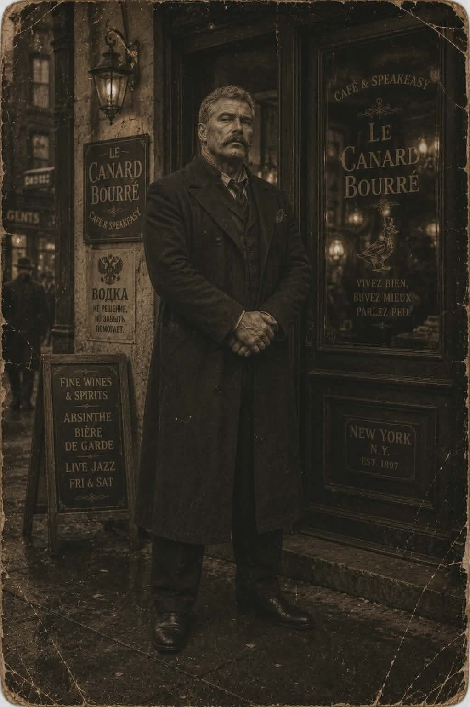

# Player Characters:

```{=html}
<div class="card-row"
 
 <!-- Dom -->
  <div class="flip-card">
    <div class="flip-card-inner">
      <div class="flip-card-front">
        
      </div>
      <div class="flip-card-back">
        <h3>Dominic<br>The Boss</h3>
        <p>Probably a werewolf.</p>
      </div>
    </div>
  </div>   
  
  <!-- Raymond -->
  <div class="flip-card">
    <div class="flip-card-inner">
      <div class="flip-card-front">
        
      </div>
      <div class="flip-card-back">
        <h3>Raymond<br>The Driver</h3>
        <p>Too old for this shit.</p>
      </div>
    </div>
  </div>   

  <!-- the gypsy -->
  <div class="flip-card">
    <div class="flip-card-inner">
      <div class="flip-card-front">
        
      </div>
      <div class="flip-card-back">
        <h3>The Gypsy</h3>
        <p>...</p>
      </div>
    </div>
  </div>  
  
  <!-- Amalfi -->
  <div class="flip-card">
    <div class="flip-card-inner">
      <div class="flip-card-front">
        
      </div>
      <div class="flip-card-back">
        <h3>Amalfi Agnolotti</h3>
        <p>Poon hound</p>
      </div>
    </div>
  </div>  
  
</div>
```