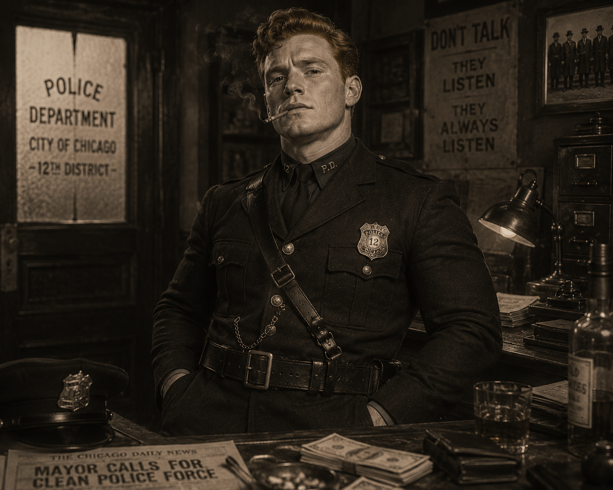
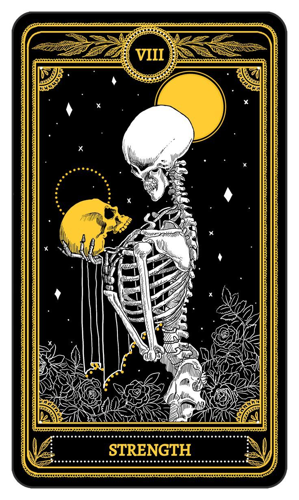
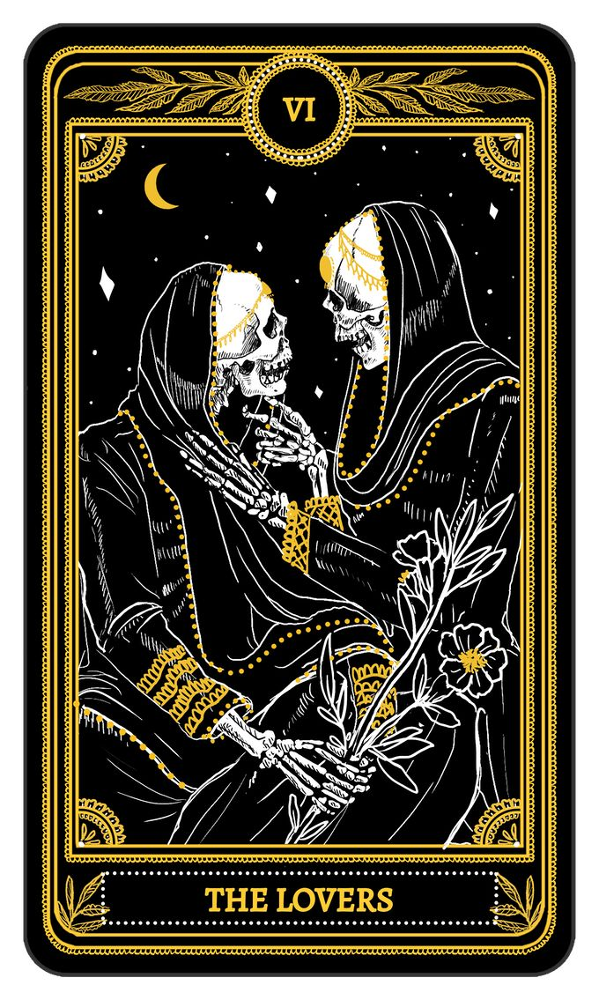
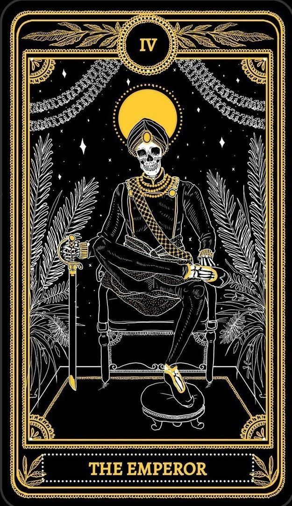
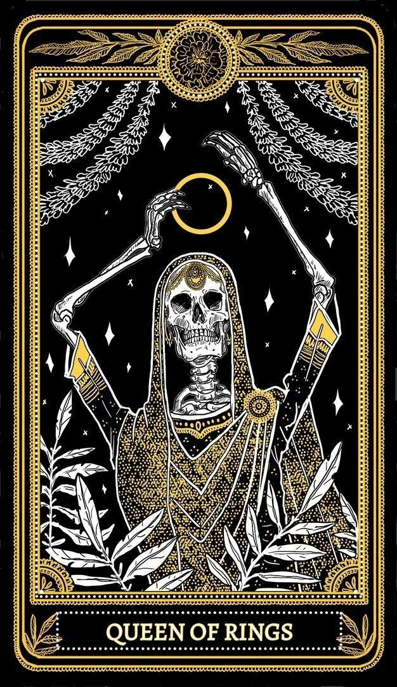
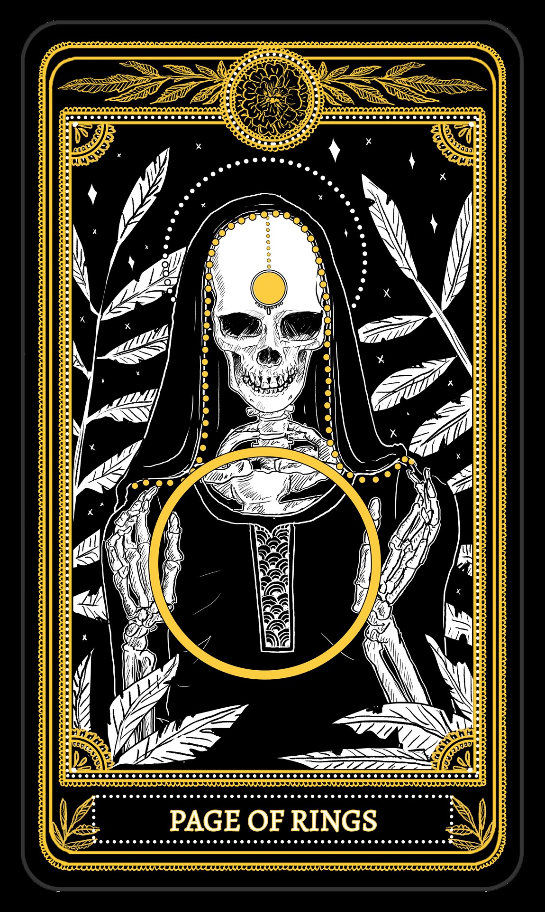
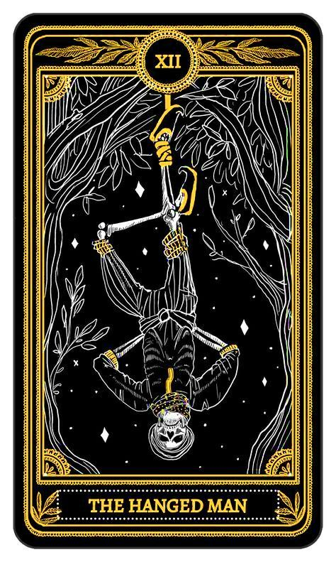
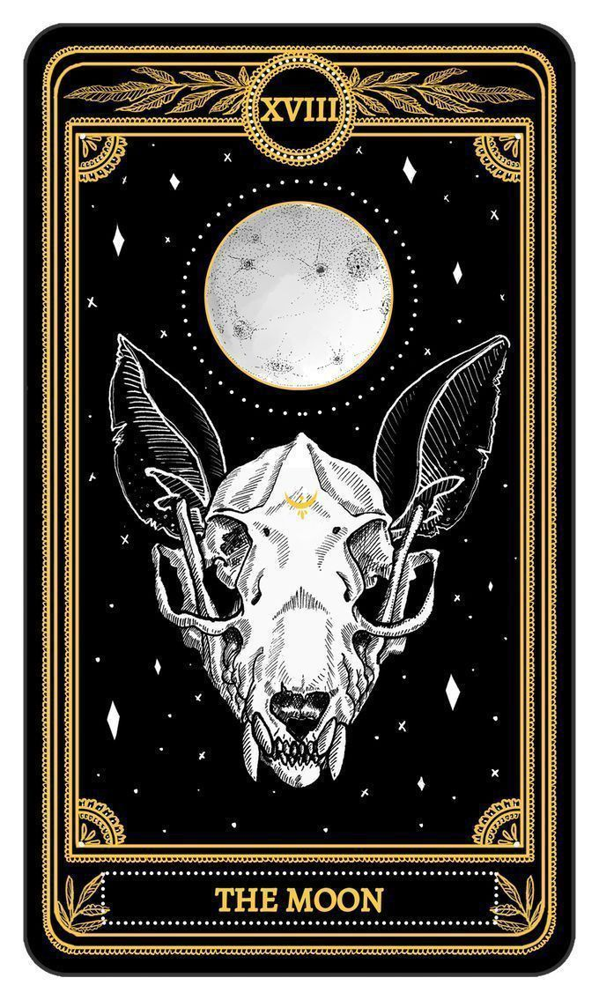
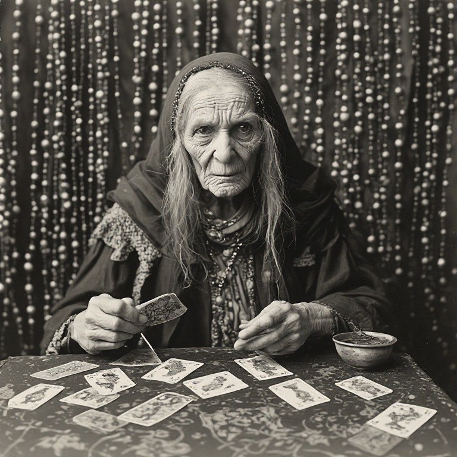
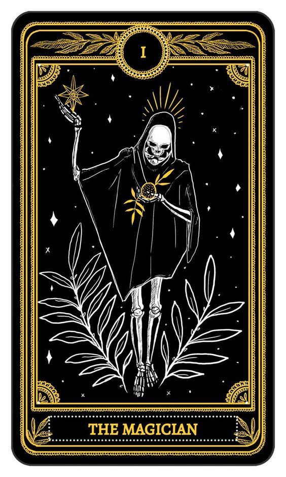

* * *
* * *

# Player Characters:

```{=html}
<div class="card-row">

  <!-- Dom -->
  <div class="flip-card">
    <div class="flip-card-inner">
      <div class="flip-card-front">
        
        <div class="front-text">
        <h1>Dominic</h1>
        <h2>The Boss</h2>
        </div>
      </div>
      <div class="flip-card-back">
        
      </div>
    </div>
  </div>

  <!-- Red -->
  <div class="flip-card">
    <div class="flip-card-inner">
      <div class="flip-card-front">
        
        <div class="front-text">
        <h1>Red</h1>
        <h2>The Muscle</h2>
        </div>
      </div>
      <div class="flip-card-back">
        
      </div>
    </div>
  </div>

  <!-- Raymond -->
  <div class="flip-card">
    <div class="flip-card-inner">
      <div class="flip-card-front">
        
        <div class="front-text">
        <h1>Raymond</h1>
        <h2>The Driver</h2>
        </div>
      </div>
      <div class="flip-card-back">
        
      </div>
    </div>
  </div>

  <!-- The Gypsy -->
  <div class="flip-card">
    <div class="flip-card-inner">
      <div class="flip-card-front">
        
        <div class="front-text">
        <h1>The Gypsy</h1>
        </div>
      </div>
      <div class="flip-card-back">
        
      </div>
    </div>
  </div>

  <!-- Amalfi -->
  <div class="flip-card">
    <div class="flip-card-inner">
      <div class="flip-card-front">
        
        <div class="front-text">
        <h1>Amalfi</h1>
        <h2>The Looks</h2>
        </div>
      </div>
      <div class="flip-card-back">
        
      </div>
    </div>
  </div>

</div>
```

<br>
<br>

* * *
* * *

# Non-player Characters


```{=html}
<div class="card-row"
 
 <!-- Alexi -->
  <div class="flip-card">
    <div class="flip-card-inner">
      <div class="flip-card-front">
        
        <div class="front-text">
        <h1>Golikov Alexi</h1>
        <h2>The Boss</h2>
        </div>
      </div>
      <div class="flip-card-back">
        
      </div>
    </div>
  </div>   
  
  <!-- Anastasia -->
  <div class="flip-card">
    <div class="flip-card-inner">
      <div class="flip-card-front">
        
        <div class="front-text">
        <h1>Golikov Anastasia</h1>
        <h2>The Boss</h2>
        </div>
      </div>
      <div class="flip-card-back">
        
        <p>AWOOGA!</p>
      </div>
    </div>
  </div>   
  
  <!-- Anna -->
  <div class="flip-card">
    <div class="flip-card-inner">
      <div class="flip-card-front">
        
        <div class="front-text">
        <h1>Golikov Anastasia</h1>
        <h2>The Princess</h2>
        </div>
      </div>
      <div class="flip-card-back">
        
      </div>
    </div>
  </div>   

  <!-- Zanatovi -->
  <div class="flip-card">
    <div class="flip-card-inner">
      <div class="flip-card-front">
        
        <div class="front-text">
        <h1>Zanatovi Capitani</h1>
        <h2>The Big Bad</h2>
        </div>
      </div>
      <div class="flip-card-back">
        
      </div>
    </div>
  </div>  
  
  <!-- Felix -->
  <div class="flip-card">
    <div class="flip-card-inner">
      <div class="flip-card-front">
        
        <div class="front-text">
        <h1>Felix</h1>
        <h2>The Cat</h2>
        </div>
      </div>
      <div class="flip-card-back">
        
      </div>
    </div>
  </div>  
  
  <!-- Gyspy Matron -->
  <div class="flip-card">
    <div class="flip-card-inner">
      <div class="flip-card-front">
        
        <div class="front-text">
        <h1>Gypsy Matron</h1>
        <h2>Fortune Teller</h2>
        </div>
      </div>
      <div class="flip-card-back">
        
      </div>
    </div>
  </div>  
  
  
</div>
```