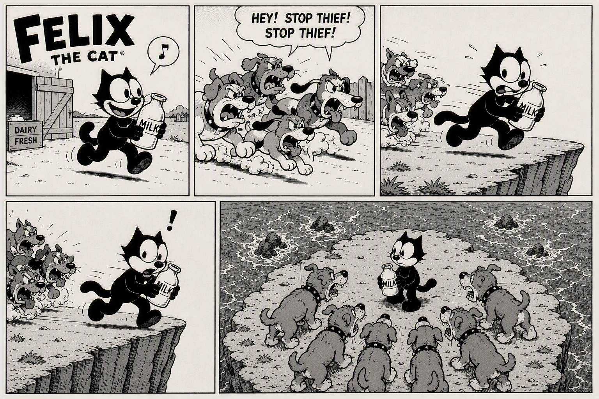
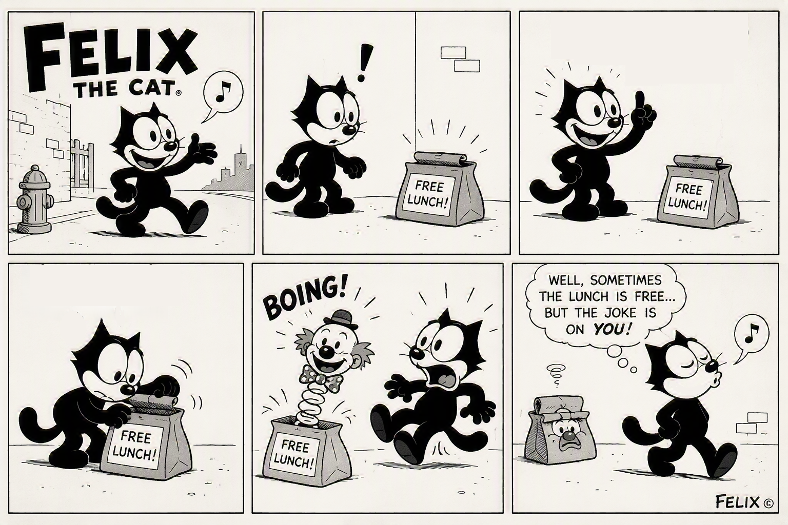
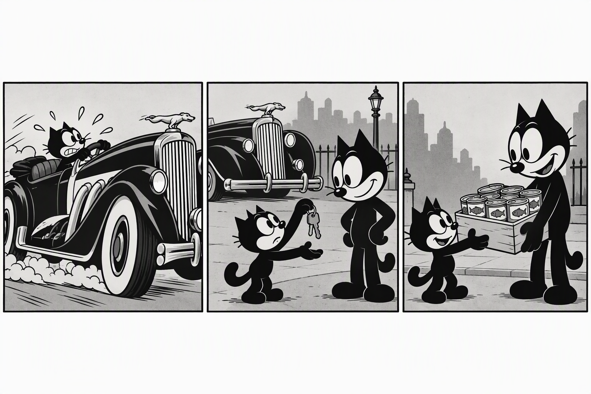

```{=html}
<div class="page-turn" id="pageTurn">
  <div class="page current">
    
  </div>
  <div class="page upcoming">
    
  </div>
  <div class="page upcoming">
    
  </div>
  <div class="page upcoming">
    
  </div>
  <div class="page upcoming">
    
  </div>
  <div class="page upcoming">
    
  </div>
</div>

<div class="page-turn-nav">
  <button id="prevBtn">← Prev</button>
  <button id="nextBtn">Next →</button>
</div>
<div class="page-turn-counter" id="counter"></div>
```

