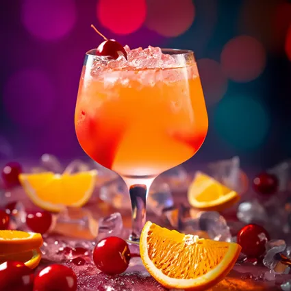
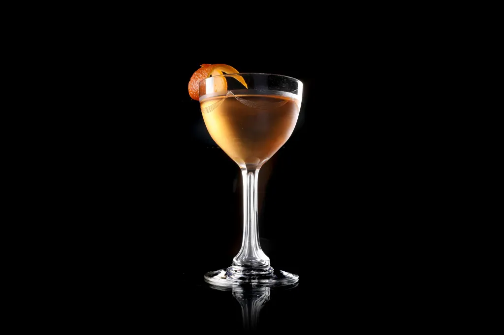
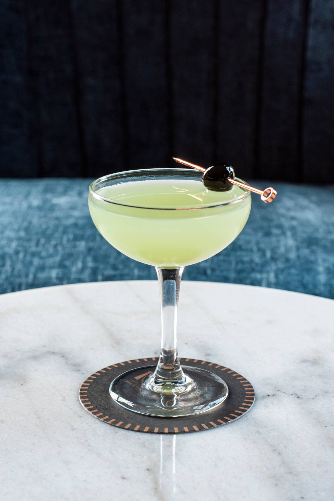
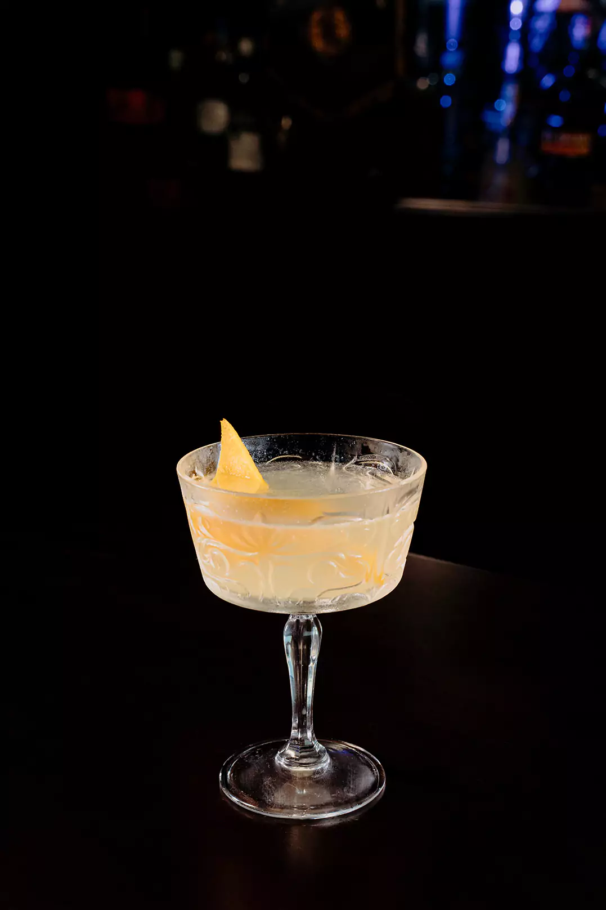
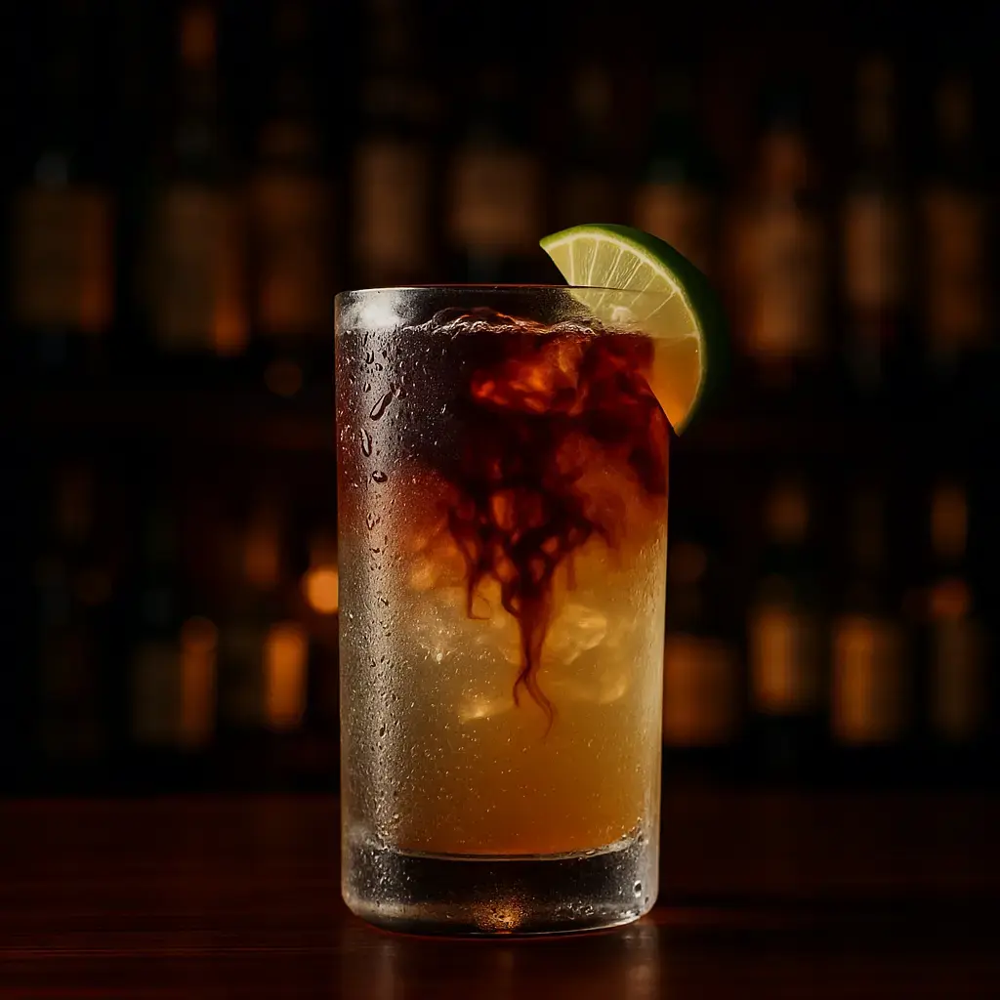
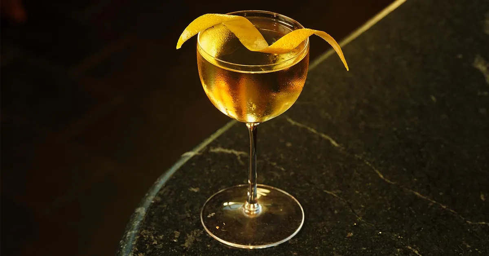
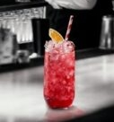
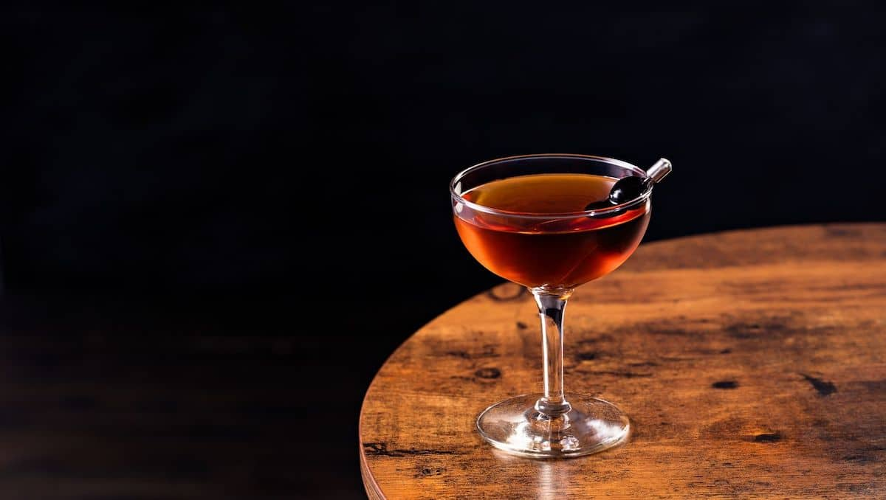
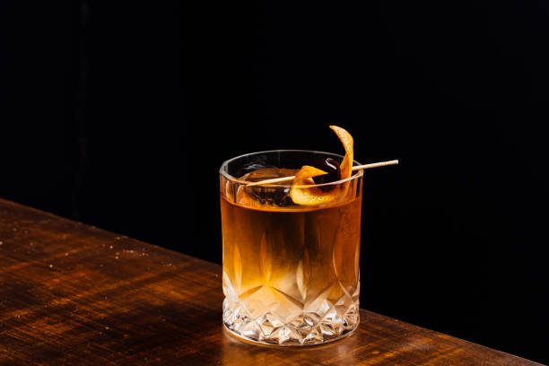
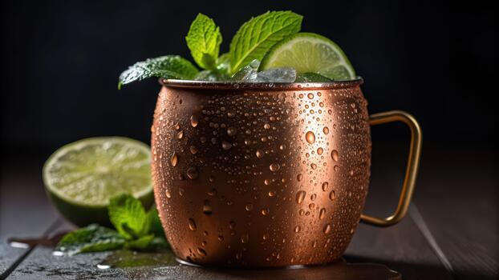

Session 1: Moscow Mule - picking up illicit goods
Session 2: Old fashioned - Drunk by ray before the chase
Session 3: No 10. Manhattan - Train reference
Session 4.: Spilt milk - Amalfi leaves
Session 5: Poet's dream. Night market cocktail incoming
Session 6: the one where we rescue the dude
Session 7, 13/06/2026: Corpse Reviver - Dead rising in warehouse
Session 8, 20/09/2026: The Last word - Alexi's death and a bitter last word from Dom
Session 9, 27/09/2026: The Gypsy Queen
Session 10, : 
Session 11, 1/11/2026: 


```{=html}
<div class="timeline">

  <div class="timeline-item">
    <div class="timeline-dot">
      
    </div>
    <div class="timeline-name">Car Crash #2</div>
    <div class="timeline-details">
      The gang tries to enter the night market, but are denied. <br>
      Got to go get those fae booze they ditched. <br>
      Dom has a car crash that puts him into coma. <br>
      Ray meets the cartoonist of Felix.
    </div>
  </div>

  <div class="timeline-item">
    <div class="timeline-dot">
      
    </div>
    <div class="timeline-name">Gypsy Queen</div>
    <div class="timeline-details">
      Ray identifies Alexi's body. <br>
      Dom asks the Gypsy for help. <br>
      The gypsy matron reveals the truth about Anna. <br>
      Anna goes missing. red identifies she has been banished to the shadow realm!
    </div>
  </div>

  <div class="timeline-item">
    <div class="timeline-dot">
      
    </div>
    <div class="timeline-name">The Last Word</div>
    <div class="timeline-details">
      Alexi and Dom have a falling out. Dom leave the gang. <br>
      Alexi is informed by the Gypsy that Zapitovi is a fae. <br>
      Alexi reveals that Zapitovi was killed 10 years ago. <br>
      Anna gets her fortune read by the Gypsy. <br>
      Then Alexi is blown up in a car bomb.
    </div>
  </div>

  <div class="timeline-item">
    <div class="timeline-dot">
      
    </div>
    <div class="timeline-name">Corpse Reviver</div>
    <div class="timeline-details">
      After tracking down the Capitani who kidnapped some Golikov men, <br>
      The gang massacre the lot and once again kill Zapitovi. <br>
      Then all the dead are resurrected. 
    </div>
  </div>
  
  <div class="timeline-item">
    <div class="timeline-dot">
      
    </div>
    <div class="timeline-name">Dark N Stormy</div>
    <div class="timeline-details">
      After tracking down the Capitani who muscled in on Golikov turf, <br>
      The Gypsy gets the drop and slashes some faces. <br>
      Ray and Red burn all their cars. <br>
      The kidnapped Golikov gang member probably died...
    </div>
  </div>

  <div class="timeline-item">
    <div class="timeline-dot">
      
    </div>
    <div class="timeline-name">Poet's Dream</div>
    <div class="timeline-details">
      The gang head to the dream like, fae night market. <br>
      Raymond meets Felix the cat. 
    </div>
  </div>

  <div class="timeline-item">
    <div class="timeline-dot">
      
    </div>
    <div class="timeline-name">Spilt Milk</div>
    <div class="timeline-details">
      Amalfi want more pay. Doesn't realise Alexi wants him to join the gang proper. <br>
      He runs. Someone has been messing with Golikov racketeering. <br>
      Red and Dom track down the Capitani dogs. <br>
      We introduce the Gypsy. 
    </div>
  </div>

  <div class="timeline-item">
    <div class="timeline-dot">
      
    </div>
    <div class="timeline-name">No. 10 Manhattan</div>
    <div class="timeline-details">
      The gang board a train to retrieve more fae booze. <br>
      The Booze is cursed by Zapitovi. <br>
      The train is hijacked, Dom and Amalfi have to jump from the train. <br>
      Ray and Red ditch the booze in South side.
    </div>
  </div>

  <div class="timeline-item">
    <div class="timeline-dot">
      
    </div>
    <div class="timeline-name">Old Fashioned</div>
    <div class="timeline-details">
      The gang kill Capitani thugs and Zapitovi and the brothel. <br>
      Returning with the goods. 
    </div>
  </div>

  <div class="timeline-item">
    <div class="timeline-dot">
      
    </div>
    <div class="timeline-name">Moscow Mule</div>
    <div class="timeline-details">
      The gang track down fae booze in a Capitani brothel
    </div>
  </div>

</div>
```   
                                                 


The List of items:
Black candles, preferably beeswax <- Got
Graveyard soil, taken from an unmarked grave <- go kill a guy and bury him. Then take that soil. 
Blood of the pure and willing <- 
Silver coin minted in a year of death <- 1917 year of death. Need 1913
Raven feather <- Got
Ashes of a burned love letter <- got Ray's letter. 
Tear of a banshee <- 
Bone of a saint who was never canonised <- someone who has been given the title 'Blessed'. Or a local saint
Water collected from the River that runs through the underworld <- 
Whisper stolen from a sleeping god <- 
Name of a person who has never existed <- the Gypsy's name
Moonstone that has never seen moonlight <- obtained a few
shadow of a person who is not present <- one of the souls possessing the Gypsy
